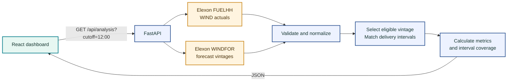

<p align="center">
  
</p>

<p align="center">
  
</p>

<p align="center">
  <a href="https://k7v3m9q2-five.vercel.app"></a>
  <a href="https://k7v3m9q2-five.vercel.app/api/health"></a>
  <a href="https://github.com/ankush-48/k7v3m9q2"></a>
</p>

<p align="center">
  
  
  
  
  
</p>

---

## ⚡ The idea

**What forecast was available before the day-ahead decision - and how close was it to actual wind generation?**

Wind Vintage is a full-stack analytics dashboard that compares UK national wind forecasts with actual generation for **January 2026**. It selects a forecast vintage using a configurable publication cutoff, then displays forecast accuracy and interval coverage.

> **Analysis prototype:** this dashboard explains forecast uncertainty. It does not place orders or recommend electricity purchases.

## 📡 At a glance

<p align="center">
  
  
  
  
</p>

### Recorded default-cutoff snapshot

| **MAE** | **Forecast bias** | **RMSE** | **Coverage** |
|:---:|:---:|:---:|:---:|
| **2,003 MW** | **+1,806 MW** | **2,470 MW** | **50.0%** |
| Average absolute miss | Forecast ran high | Larger misses count more | 744 of 1,488 intervals |

*Recorded Elexon-derived result for the 12:00 Europe/London cutoff. Accuracy metrics use matched intervals only; coverage is shown so the sample size stays visible.*

## ✨ Explore the dashboard

- **Change the forecast cutoff** to compare available day-ahead assumptions.
- **Scan the daily profile** to compare actual and forecast generation.
- **Filter the chart and interval table** to part of January.
- **Inspect interval detail**, including delivery time and forecast publication time.
- **Export the interval data** as CSV.

The cutoff control reloads and recalculates the analysis. The chart-range control filters the chart and table; the metric cards continue to show the full-month results.

## 🧭 Data flow



## 🧠 Forecast-vintage logic

For each delivery interval, the app selects the **latest valid forecast published at or before the selected cutoff**. Forecasts published later are excluded to prevent future information from leaking into the evaluation.

The default is **12:00 Europe/London on the calendar day before delivery**. The challenge does not specify an exact decision time, so this is a transparent pilot assumption, not an official market deadline. The available cutoffs are 10:00, 12:00, 16:00, and 18:00.

Timestamps are normalized to UTC for processing. Forecasts and actuals are joined by delivery `startTime`. Unmatched intervals remain visible and do not contribute to paired accuracy metrics.

## 🌱 Data and methodology

This project uses only national wind-generation data from the public Elexon BMRS API:

| Stream | Dataset | Fields used |
|---|---|---|
| Actual generation | `FUELHH`, filtered to `fuelType=WIND` | `startTime`, `generation` |
| Forecast vintages | `WINDFOR` | `startTime`, `publishTime`, `generation` |

The analysis period is **1 January through 31 January 2026**. Actual generation is measured in MW and aligned to half-hour delivery intervals.

- **MAE** and **RMSE** describe error magnitude in MW.
- **Bias** is forecast minus actual; positive values mean over-forecasting.
- **MAPE** excludes zero-actual intervals.
- The daily chart shows average MW across matched intervals, not summed energy.
- Missing intervals are not interpolated or fabricated.
- Demand, other generation types, and procurement volumes are outside scope.
- Elexon results are cached in-process for about 15 minutes.

See [`docs/data-verification.md`](docs/data-verification.md) for API investigation and snapshot details.

## 🧰 Built with

| Layer | Tools |
|---|---|
| Frontend | React, Vite, Recharts, Lucide |
| Backend | Python, FastAPI |
| Data | Elexon BMRS FUELHH and WINDFOR |
| Deployment | Vercel |
| Containers | Docker and Docker Compose configuration |

## 🚀 Run locally

### Requirements

- Python 3.12+
- Node.js 20+
- pnpm 11

### 1. Start the backend

From the project root, in PowerShell:

```powershell
cd backend
py -m venv .venv
.\.venv\Scripts\Activate.ps1
pip install -r requirements.txt
uvicorn app.main:app --reload --port 8000
```

### 2. Start the frontend

Open a second PowerShell window from the project root:

```powershell
cd frontend
pnpm install --frozen-lockfile
pnpm run dev
```

Open the Vite URL printed in the terminal. During local development, requests to `/api` are proxied to the backend on port 8000.

The backend calls Elexon's public API. No API key is needed for the endpoints used by this project. Optional settings are listed in [`.env.example`](.env.example).

## 🔌 API

| Endpoint | Purpose |
|---|---|
| `GET /api/health` | Service health check |
| `GET /api/analysis?cutoff=12:00` | January analysis for the chosen cutoff |

The analysis response contains the period, cutoff rule, metrics, daily chart values, interval records, source information, and limitations. The cutoff must use `HH:MM` format.

## 🐳 Docker

From the project root:

```powershell
docker compose up --build
```

Then open [http://localhost:8000](http://localhost:8000). Stop the service with `Ctrl+C`, then run:

```powershell
docker compose down
```

Docker configuration is included, but its build and runtime have not been independently verified in the development environment.

## 🧪 Tests and build

Run the backend unit tests:

```powershell
cd backend
py -m unittest discover -s tests -v
```

Build the frontend:

```powershell
cd frontend
pnpm run build
```

Backend tests cover cutoff eligibility, post-cutoff exclusion, duplicate actuals, timestamp normalization, interval matching, and January date scope.

## 🗂️ Project structure

```text
backend/
  app/
    analytics.py       Timestamp cleanup, vintage selection, and metrics
    elexon.py          Elexon API client and source queries
    main.py            FastAPI endpoints and static frontend serving
  tests/
    test_analytics.py  Analytics and cutoff unit tests
frontend/
  src/
    main.jsx           React dashboard and interactions
    styles.css         Responsive dashboard styling
  package.json
  pnpm-lock.yaml
docs/
  data-verification.md
  demo-script.md
  requirements-checklist.md
  submission-checklist.md
Dockerfile
docker-compose.yml
pyproject.toml
requirements.txt
.env.example
README.md
```

## ⚠️ Known limitations

- The analysis period is fixed to January 2026.
- The cutoff is a configurable pilot assumption because the challenge does not specify a decision time.
- Forecast coverage in the recorded default-cutoff snapshot is 50%; missing intervals are not interpolated.
- The analysis covers national wind generation only, not demand or other generation sources.
- Docker configuration is present, but its build and runtime have not been independently verified.
- This is an analytics prototype, not a production procurement or trading system.

## ☁️ Deployment

**Live dashboard:** [k7v3m9q2-five.vercel.app](https://k7v3m9q2-five.vercel.app)  
**API health:** [k7v3m9q2-five.vercel.app/api/health](https://k7v3m9q2-five.vercel.app/api/health)  
**Public source:** [github.com/ankush-48/k7v3m9q2](https://github.com/ankush-48/k7v3m9q2)

The project is configured for Git-based deployment on Vercel from the repository root. The root `pyproject.toml` configures the FastAPI entry point and frontend build.

## 🤖 AI disclosure

OpenAI Codex assisted with requirements analysis, implementation, and documentation. Data handling and reported results were reviewed against the challenge requirements and Elexon API evidence.

---

<p align="center">
  <sub>Built to make forecast vintage, error, and coverage easier to see.</sub>
</p>
