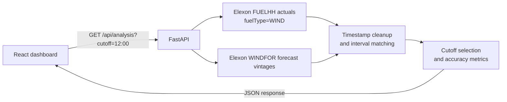

<div align="center">

# 🌬️ Wind Vintage

### UK wind forecast accuracy, made easier to inspect.

A full-stack dashboard comparing Elexon wind forecasts with actual generation for January 2026.

[**Open the live dashboard**](https://k7v3m9q2-five.vercel.app) · [**Check API health**](https://k7v3m9q2-five.vercel.app/api/health)


</div>

---

## ✨ What it does

Wind Vintage helps explore how UK national wind forecasts compared with actual generation during January 2026. It selects the latest eligible forecast for each delivery interval, then summarizes forecast error and data coverage.

- Compare actual and forecast generation on a daily chart.
- Change the assumed day-ahead forecast cutoff.
- Inspect forecast and actual values by half-hour interval.
- See when each selected forecast was published.
- Export interval details as CSV.

> This is an analysis dashboard. It does not place orders or recommend electricity purchases.

## 📊 Dashboard measures

| Measure | What it means |
|---|---|
| **MAE** | Average absolute forecast error, in MW |
| **Bias** | Average signed error; positive means forecast was higher than actual |
| **RMSE** | Error measure that gives larger misses more weight |
| **Coverage** | Share of expected intervals with both a forecast and an actual |

The chart range control filters the chart and interval table. Metric cards continue to summarize the full analysis period.

## ⚙️ How it works



### Forecast selection

For every January delivery interval, the app selects the latest valid WINDFOR forecast published at or before the selected cutoff. Forecasts published after the cutoff are excluded.

The default cutoff is **12:00 Europe/London on the previous calendar day**. The challenge does not specify an exact decision time, so this is a documented pilot assumption, not an official market deadline. Available cutoff choices are 10:00, 12:00, 16:00, and 18:00.

Timestamps are normalized to UTC for processing. Forecasts and actuals are matched by delivery `startTime`. Intervals without a matching forecast or actual remain visible but are excluded from paired accuracy metrics.

## 🌱 Data and scope

This project uses only national wind data from the public Elexon BMRS API:

- **Actual generation:** `FUELHH`, filtered to `fuelType=WIND`
- **Forecast vintages:** `WINDFOR`
- **Delivery interval:** `startTime`
- **Forecast publication time:** `publishTime`
- **Generation value:** `generation`, in MW

The analysis covers delivery intervals from **1 January through 31 January 2026**. It does not include electricity demand, other fuel types, or procurement volumes.

The recorded default-cutoff result was **744 matched intervals out of 1,488 (50.0% coverage)**. Accuracy metrics describe only matched intervals. See `docs/data-verification.md` for the API snapshot and metric details.

### Metrics and caveats

- MAE and RMSE are reported in MW.
- Signed bias is calculated as forecast minus actual.
- MAPE excludes intervals with zero actual generation.
- The daily chart shows average MW across matched half-hour intervals; it does not show summed energy.
- Forecast error is evidence about uncertainty, not a direct measure of procurement volume or trading performance.
- Elexon results are cached in-process for about 15 minutes.

## 🚀 Run locally

### Requirements

- Python 3.12 or newer
- Node.js 20 or newer
- pnpm 11

### Start the backend

In PowerShell, from the project root:

```powershell
cd backend
py -m venv .venv
.\.venv\Scripts\Activate.ps1
pip install -r requirements.txt
uvicorn app.main:app --reload --port 8000
```

### Start the frontend

Open a second PowerShell window from the project root:

```powershell
cd frontend
pnpm install --frozen-lockfile
pnpm run dev
```

Open the Vite URL printed in the terminal. During local development, requests to `/api` are proxied to the backend on port 8000.

The backend calls Elexon's public API. No API key is needed for the endpoints used by this project. Optional settings are documented in `.env.example`.

## 🔌 API

| Endpoint | Description |
|---|---|
| `GET /api/health` | Returns service health |
| `GET /api/analysis?cutoff=12:00` | Returns January analysis for the selected cutoff |

The analysis response includes the period, cutoff rule, metrics, daily chart values, interval records, source information, and limitations. The cutoff must use the `HH:MM` format.

## 🐳 Docker

From the project root:

```powershell
docker compose up --build
```

Then open [http://localhost:8000](http://localhost:8000). Stop the service with `Ctrl+C`, then run:

```powershell
docker compose down
```

Docker configuration is included. A Docker build and run have not been independently verified in the development environment.

## ✅ Tests and build

Run the backend unit tests:

```powershell
cd backend
py -m unittest discover -s tests -v
```

Build the frontend:

```powershell
cd frontend
pnpm run build
```

Backend tests cover forecast cutoff eligibility, post-cutoff exclusion, duplicate actuals, timestamp normalization, interval matching, and January date scope.

## ☁️ Deployment

The production app is deployed on Vercel:

- **Dashboard:** [k7v3m9q2-five.vercel.app](https://k7v3m9q2-five.vercel.app)
- **Health endpoint:** [k7v3m9q2-five.vercel.app/api/health](https://k7v3m9q2-five.vercel.app/api/health)
- **Source repository:** [github.com/ankush-48/k7v3m9q2](https://github.com/ankush-48/k7v3m9q2)

The project is configured for a Git-based Vercel deployment from the repository root. The root `pyproject.toml` configures the FastAPI entry point and frontend build.

## 🗂️ Project structure

```text
backend/
  app/
    analytics.py       Timestamp normalization, forecast selection, and metrics
    elexon.py          Elexon API client and source queries
    main.py            FastAPI routes and built frontend serving
  tests/
    test_analytics.py  Forecast and analytics unit tests
frontend/
  src/
    main.jsx           React dashboard and interactions
    styles.css         Responsive dashboard styling
  package.json
  pnpm-lock.yaml
docs/
  data-verification.md     API investigation and result evidence
  demo-script.md           Timed two-part demo script
  requirements-checklist.md
  submission-checklist.md
Dockerfile
docker-compose.yml
pyproject.toml
requirements.txt
.env.example
README.md
```

## ⚠️ Known limitations

- The analysis period is fixed to January 2026.
- The cutoff is a configurable pilot assumption because the challenge does not define a decision time.
- Forecast coverage in the recorded default-cutoff result is 50%; missing intervals are not interpolated.
- Only national wind generation is analyzed. Demand and other generation sources are outside scope.
- Docker configuration is present, but its build and runtime have not been independently verified.
- This is an analysis prototype, not a production procurement or trading system.

## 🤖 AI disclosure

OpenAI Codex assisted with requirements analysis, implementation, and documentation. Data handling and reported results were reviewed against the challenge requirements and Elexon API evidence.
